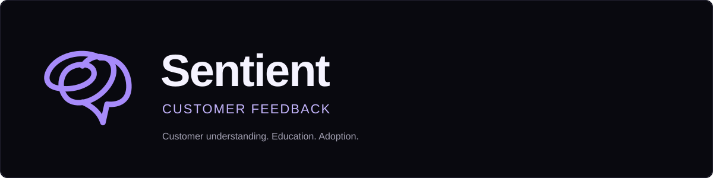

<p align="center"></p>

<p align="center">A project by Pahul Sachdeva · Customer understanding, education, and adoption</p>

## Why I'm building this

I work in AI Enablement and Customer Sentiment at EliseAI, and I studied neuroscience at Colgate. One question I keep coming back to is what we should measure when we're trying to help someone get comfortable with AI.

A customer can give a product a good rating and still struggle to use it. Someone else might sound frustrated but keep coming back because it solves a problem they care about. I want to understand what sits behind those reactions, and how customer education could help.

Sentient is where I'm working through that idea: taking a conversation, finding the part worth following up on, and turning it into something we could test.

## The example I'm using

To test this idea without using any of my company's internal examples, I built a set of fictional user interviews. For this project, I'm treating the product as a **B2C SaaS AI assistant**, rather than the B2B setting I work in at EliseAI.

Think of a subscription chatbot people use to study, write, plan their day, or learn to code. The product question is simple: **what helps someone get a useful first result, trust it appropriately, and find a reason to return?**

The workspace follows five people across 12 conversations:

| Person | What they're trying to do | What gets in the way |
|---|---|---|
| Maya | Study with quizzes made from her notes | Getting started and knowing when to check an answer |
| Jordan | Write cover letters that still sound like them | Keeping control of edits and understanding the paid offering |
| Alex | Continue writing across a laptop and phone | Finding saved chats and understanding sync timing |
| Sam | Fit an AI assistant into daily planning | Remembering to return and fitting an existing routine |
| Riley | Learn Python with examples they can run | Following explanations and testing code safely |

## One example, from feedback to a test

Maya opens the assistant to study for an exam. She wants a quiz, but the onboarding takes her through six screens and she leaves before trying it.

That raises a question: is the problem that the product asks her to do too much before she gets a useful result, or that it hasn't shown her how to start?

Sentient keeps her original words beside those possible explanations. From there, I can propose a small test: give new study users a starter prompt that turns their notes into a short quiz, then compare how many complete their first quiz.

The main outcome would be **first quiz completion**. I'd also look at whether people return to study again and whether they understand the need to verify answers. That connects an education decision to both activation and responsible use.

[Walk through the case study →](docs/case-study.md)

## What you can do

- Search the interviews, filter by stage, and read the full conversation.
- Inspect the sentence behind a behavioral interpretation and consider another explanation.
- Save a Supported, Not supported, or Uncertain review with reasoning; filter and export the current evidence reviews.
- Follow the same person over time to see how their experience changes.
- Explore experiment ideas with an intervention, outcome, and suggested test design.
- Import a JSON file to try the workflow with your own examples.

## What I'd measure

I'm interested in how customer feedback connects to learning and actual use. These are the measures I'd explore for the consumer assistant:

| Question | Measure I'd start with |
|---|---|
| Did someone get value in their first visit? | Completion of a useful task, such as a quiz or revised draft |
| Did the guidance help them understand what to do? | Task success before and after guidance, plus a short understanding check |
| Can they do it themselves next time? | Successful task completion without assistance |
| Do they have a reason to return? | Repeat successful use within a defined follow-up period |
| Do they know when to verify the output? | Recognition of cases where an answer needs checking |
| Is the paid offering clear? | Understanding of the paid features, followed by trial-to-paid conversion |

The interviews help choose a question. Product events and a well-designed experiment would be needed to measure the outcome.

## How it works

The current analysis uses a small set of readable phrase rules. They look for language about effort, uncertainty, control, trust, routines, and expectations. Each match keeps the source sentence and an alternative explanation so a reviewer can decide whether the interpretation makes sense.

I started with rules because I want to understand and inspect the behavior before adding a model. An optional LLM integration is on the roadmap. The next step is to evaluate the approach against independently reviewed examples, including ones where it should say there isn't enough evidence.

The app runs in the browser, with a small Node server for local development. Imports stay in that browser's storage and can be cleared from Research Workspace.

[Development notes](docs/development-notes.md) · [Architecture](docs/architecture.md) · [Methodology](docs/methodology.md) · [Evaluation](docs/evaluation.md)

## Run locally

Use Node.js 20 or later. No dependency installation or API key is needed.

```bash
npm start
# Open http://localhost:4173
```

```bash
npm run check
npm test
npm run evaluate # Authored construct cases, per-label errors, and abstention
```

To import examples, use an array with `id`, `account` (the person's name or ID), `role` (their use case), `date`, and `text`. `channel` and `stage` are optional.

```json
[{"id":"I-001","account":"Taylor","role":"Study help","date":"2026-04-01","text":"I wasn't sure which step mattered first."}]
```

## Where I'm taking it next

The next pieces are a hosted demo, better handling of paraphrases and negation, and independently reviewed examples. Reviewer decisions now save alongside evidence in the browser. I'd also like to connect the interview view to task and retention events so I can work through the measurement questions above.

[Roadmap](docs/roadmap.md) · [Contributing](CONTRIBUTING.md) · [MIT license](LICENSE)

