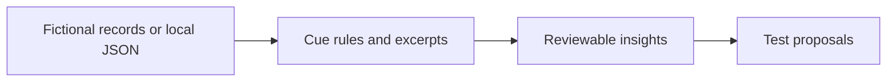

<p align="center"></p>

<p align="center"><strong>Behavioral science × transparent analysis × growth experimentation</strong></p>

## Why this exists

“Positive” and “negative” sentiment often miss the useful question: *what makes a product difficult to adopt, and what could a team test next?* SENTIENT connects customer language to cautious behavioral hypotheses, exact evidence, and measurable experiment ideas.

## The question behind the project

I'm Pahul Sachdeva. I work in **AI Enablement and Customer Sentiment at EliseAI**, and I studied neuroscience at Colgate University. My work has made me curious about how we define customer success when the product itself changes the way people work.

I'm exploring what useful metrics for customer success and customer education could look like: how customers describe their experience, what they understand after training, whether they can complete a workflow independently, and whether that learning becomes sustained product use. A rating can start the conversation; the explanation behind it helps identify what to investigate next.

SENTIENT is my independent space to build on those questions. It connects customer feedback, behavioral research, and experiment design so I can explore how education and enablement might support adoption—and how a team could measure that change.

### What I want to measure

These are **proposed measurement questions for this project**, rather than a description of EliseAI's internal scorecards. The current demo surfaces conversation evidence and experiment ideas; it does not calculate the measures below.

| Dimension | Question I'm exploring | Candidate measure for a future study |
|---|---|---|
| Customer experience | What is driving the customer's rating? | Rating paired with a coded explanation and supporting excerpt |
| Learning | Does the customer understand the workflow after education? | Scenario-based knowledge check before and after training |
| Independent use | Can the customer complete the task without help? | Successful task completion without assistance |
| Activation | How quickly does the customer reach a useful first outcome? | Time to first successful workflow |
| Sustained adoption | Does the workflow become part of regular work? | Repeat successful use over a defined follow-up period |
| Education effectiveness | Does a specific educational change improve an outcome? | Difference in task success or activation between randomized groups |

My goal is to connect what customers say with what they can do, then design a test that helps explain whether a change made a difference. That is also the connection I want to build between behavioral science, customer education, and growth.

All included organizations and conversations are **fictional**. This is an independent portfolio project, with no employer data or endorsement. No experimental uplift is reported.

## Explore the workflow

| Step | What you can do | Why it matters |
|---|---|---|
| 1. Listen | Search, filter, sort, and inspect 12 fictional conversations across five accounts; import JSON locally. | Preserve the customer's own words. |
| 2. Interpret | Examine six cue-based candidate constructs, exact source sentences, alternative explanations, and abstentions. | Make interpretations reviewable. |
| 3. See change | Explore dated follow-ups per fictional account. | Identify questions about evolving experience without assuming causality. |
| 4. Test | Inspect interventions with a hypothesis, primary outcome, and suggested design. | Connect research to activation, onboarding, and adoption decisions. |

**Example:** a fictional manager says a six-screen setup guide left them unsure where to start. The app surfaces *cognitive effort* and *uncertainty* as possible interpretations and links back to the actual sentence. It proposes testing a shorter checklist against seven-day setup completion. It does **not** claim the checklist works. [Read the case study](docs/case-study.md).

> **Release status:** The application and tests are built and stored in this private GitHub draft. Public publication, a live deployment, and actual product screenshots are pending. No unverified link or screenshot is presented as a finished demo.

## Run it

Requires Node.js 20 or later. There are no packages to install and no API keys.

```bash
npm start
# Open http://localhost:4173
```

```bash
npm run check
npm test
```

JSON import expects an array of records with `id`, `account`, `role`, `date` (`YYYY-MM-DD`), and `text`; `channel` and `stage` are optional. Import replaces the previous local import and is saved only in that browser's local storage. Try a record such as:

```json
[{"id":"I-001","account":"Fictional Co","role":"Manager","date":"2026-04-01","text":"I wasn't sure which step mattered first."}]
```

## Product and architecture

The current release is a dependency-free web application with a small Node static server and browser-side JavaScript. It runs the same transparent phrase rules on the included data and on imported records. Every finding holds an excerpt with source offsets, a candidate interpretation, an alternative, and a human review status. Counts represent records with matching cues, not population prevalence. Experiment templates are hypotheses, not model-generated discoveries.



See [architecture](docs/architecture.md), [product brief](docs/product-brief.md), and [roadmap](docs/roadmap.md). A structured-output LLM adapter is planned, but **this MVP does not call an LLM**. The honest deterministic mode keeps the public experience free and auditable.

## Research, evaluation, and responsibility

The methodology draws questions from technology acceptance and behavior change research, while treating this project's rules as unvalidated heuristics. A phrase match is not a psychological diagnosis, statistical confidence score, or causal finding. Records with no cues yield insufficient evidence. Human review and a labeled benchmark are required before applying the approach to real research. See [methodology and literature](docs/methodology.md), [evaluation](docs/evaluation.md), and [privacy](docs/privacy.md).

The automated suite checks exact evidence spans, abstention on unsupported language, count semantics, untested experiment wording, and import validation. It does not establish scientific accuracy. The demo dataset was authored to illustrate the workflow; there is no measured lift, customer sample, or model accuracy result.

## Project map

```text
apps/web/           Interface, analysis rules, and local server
data/synthetic/     Fictional conversation dataset
docs/               Brief, case study, methods, architecture, evaluation, privacy, roadmap
tests/              Node test suite
assets/             Original wordmark and icon
.github/workflows/  Syntax and test checks for future GitHub publication
```

## Next

1. Publish the repository and capture verified screenshots from the running app.
2. Conduct a usability review and create a human-annotated, consented evaluation set.
3. Add an optional schema-validated LLM pipeline with excerpt verification, abstention, and reviewer controls.

MIT licensed. Contributions should follow [CONTRIBUTING.md](CONTRIBUTING.md).
