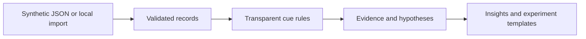

# Architecture

The dependency-free Node server serves static assets. The browser runs search, filtering, analysis, and rendering. Local JSON imports are validated and stored in `localStorage` on that browser; no server endpoint accepts uploaded data. The rules in `apps/web/analysis.js` match phrases and retain sentence offsets for provenance. They make no statistical confidence claim.

This is a deliberate MVP architecture. The model-backed pipeline, PostgreSQL persistence, organization accounts, review queue, and audit trail are future work. A future LLM adapter should return a schema-validated excerpt span, hypothesis, alternative, and abstention; it must be evaluated before use. The demo UI must never silently substitute invented model output.

**Threat boundaries:** imported records are untrusted, so the UI escapes HTML. The local server rejects paths outside the repository root and sets `X-Content-Type-Options: nosniff`. This is a demo server, not a production authentication or data processing service.
